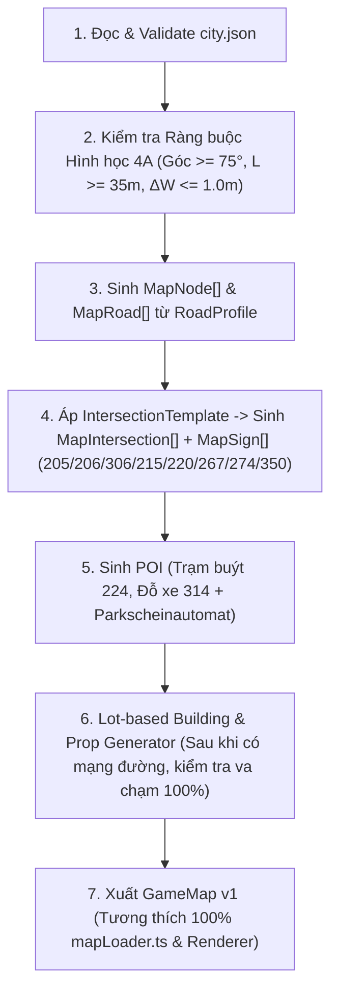

# Thiết Kế Kiến Trúc Map Kiểu Đức Tự Dựng (`city.json` & Generator Pipeline)

> **Trạng thái tài liệu**: Thiết kế kỹ thuật (Bước 4 — **Chưa viết generator, chưa sinh `city.json`, chưa sửa `mapLoader.ts` hay `ruleEngine.ts`**).
> **Nguyên tắc**: Mọi thông số kích thước (bề rộng làn, vỉa hè, làn xe đạp, khoảng cách biển báo, vạch dừng) đều trích dẫn tiêu chuẩn Đức (**RASt 06**, **ERA 2010**, **StVO / VwV-StVO**, **RMS-1**, **VzKat**) hoặc ghi rõ `"chưa xác minh"`. Mọi ràng buộc hình học nút giao đều dựa trên số liệu đo thực nghiệm từ renderer hiện tại ([`docs/junction_constraints.md`](file:///c:/Users/Tuan%20Anh/.gemini/antigravity/scratch/viet-de-fuhrerschein/docs/junction_constraints.md)).

---

## 1. Bảng Road Profile Chuẩn Đức (Bước 4B — 7 Profile)

Trong `GameMap` hiện tại ([`src/world/mapLoader.ts`](file:///c:/Users/Tuan%20Anh/.gemini/antigravity/scratch/viet-de-fuhrerschein/src/world/mapLoader.ts)), bề rộng toàn phần của lòng đường nhựa được tính tại [`roadHalfWidth`](file:///c:/Users/Tuan%20Anh/.gemini/antigravity/scratch/viet-de-fuhrerschein/src/world/roadMesh.ts#L18-L21):

$$W_{\text{road}} = (\text{lanesForward} + \text{lanesBackward}) \times \text{laneWidth}$$

Vỉa hè trong [`sidewalk.ts`](file:///c:/Users/Tuan%20Anh/.gemini/antigravity/scratch/viet-de-fuhrerschein/src/world/sidewalk.ts#L20-L21) và [`roadMesh.ts`](file:///c:/Users/Tuan%20Anh/.gemini/antigravity/scratch/viet-de-fuhrerschein/src/world/roadMesh.ts#L190-L191) có hằng số cứng `SIDEWALK_W = 2.5 m`, `SIDEWALK_H = 0.15 m` (khớp đúng chuẩn cơ bản **RASt 06 mục 6.1.6.1**: bề rộng chuẩn Gehweg $2.50\text{ m}$).

### 1.1. Bảng thông số kỹ thuật 7 Road Profile

| Mã Profile (`profileId`) | Tên chuẩn Đức | `lanesForward` / `lanesBackward` | `laneWidth` (m) | Tổng rộng lòng đường $W$ (m) | `sidewalk` (`left`/`right`) | `bikeLane` (`left`/`right`) | `parking` (`left`/`right`) | `surface` | `speedLimit` (km/h) | `priority` mặc định | Biển bắt buộc (VzKat) | Vạch kẻ đường (`markings.ts`) | Nguồn tiêu chuẩn Đức |
|---|---|---|---|---|---|---|---|---|---|---|---|---|---|
| **`wohnstrasse_30`** | Wohnstraße / Erschließungsstraße (Tempo-30-Zone) | `1` / `1` | `3.00` | **`6.00`** | `true` / `true` ($2.50\text{ m}$) | `false` / `false` (Mischverkehr) | `'none'` / `'parallel'` | `'asphalt'` | `30` | `'equal'` | `274.1` (đầu vùng), `274.2` (cuối vùng), `102` (nút RvL khuất) | Không kẻ tim đường (Mischfläche $< 6.50\text{ m}$ trong Tempo-30) | **RASt 06** Tab. 6 (EKL 4: Fahrbahn $5.50\text{–}6.00\text{ m}$); **ERA 2010** mục 2.2 (Tempo 30 đi chung lòng đường); **StVO § 45 Abs. 1c** |
| **`altstadt_pflaster_30`** | Historische Wohn-/Altstadtstraße (Đá cuội khu phố cổ) | `1` / `1` | `3.00` | **`6.00`** | `true` / `true` ($2.50\text{ m}$) | `false` / `false` | `'none'` / `'none'` | `'cobblestone'` | `30` | `'equal'` | `274.1` / `274-30` | Không kẻ tim đường trên mặt đá cuội | **RASt 06** mục 6.1.1 (Erschließungsstraße) |
| **`einbahnstrasse_30`** | Einbahnstraße (Đường 1 chiều khu dân cư) | `1` / `0` | `3.50` | **`3.50`** *(hoặc `5.50` khi nối trực tiếp nút 4 nhánh — xem mục 1.2)* | `true` / `true` ($2.50\text{ m}$) | `false` / `false` | `'parallel'` / `'none'` | `'asphalt'` | `30` | `'equal'` | Đầu `from`: `220` (Einbahnstraße); Đầu `to`: **2× `267`** (`left` + `right` nhìn ngược chiều) | Không có tim đường; vạch dừng `294` nếu cuối đường gặp `206` | **RASt 06** mục 6.1.1.4 (Einbahnstraße $3.00\text{–}3.50\text{ m}$ cho xe cứu hỏa); **VwV-StVO zu Zeichen 220 & 267** |
| **`sammelstrasse_rad_50`** | Sammelstraße / Hauptgeschäftsstraße có Radfahrstreifen | `1` / `1` | `3.50` | **`7.00`** | `true` / `true` ($2.50\text{ m}$) | `true` / `true` *(xem lưu ý 1.3)* | `'none'` / `'none'` | `'asphalt'` | `50` | `'main'` | `306` (Vorfahrtstraße), `274-50`, `237` (Sonderweg Radfahrer) | Tim đường đứt nét (`Zeichen 340`: vạch $3\text{ m}$, khoảng trống $6\text{ m}$ innerorts theo RMS-1) + vạch làn xe đạp | **RASt 06** Tab. 4 (EKL 3: Fahrbahn $6.50\text{–}7.00\text{ m}$); **ERA 2010** mục 3.2 (Radfahrstreifen chuẩn $1.85\text{ m}$ gồm $0.25\text{ m}$ Breitstrich) |
| **`gewerbestrasse_bus_50`** | Hauptammelstraße có trạm xe buýt (Linienbusverkehr) | `1` / `1` | `3.50` | **`7.00`** | `true` / `true` ($2.50\text{ m}$) | `false` / `false` | `'none'` / `'none'` | `'asphalt'` | `50` | `'main'` | `306`, `224` (Haltestelle tại trạm buýt) | Tim đường đứt nét (`Zeichen 340`), vạch Zebra (`Zeichen 293`) nếu có FGÜ | **RASt 06** mục 6.1.1.2 (Begegnung Bus/Bus ở $50\text{ km/h}$ yêu cầu $\ge 6.50\text{–}7.00\text{ m}$); **VzKat Zeichen 224** |
| **`hauptstrasse_2x2_50`** | Hauptverkehrsstraße 2+2 làn có đèn tín hiệu | `2` / `2` | `3.25` *(hoặc `3.50`)* | **`13.00`** *(hoặc `14.00`)* | `true` / `true` ($2.50\text{ m}$) | `true` / `true` | `'none'` / `'none'` | `'asphalt'` | `50` | `'main'` | `306`, `274-50` | Tim đôi/liền (`Zeichen 295`) giữa 2 chiều + vạch đứt (`Zeichen 340`) giữa 2 làn cùng chiều | **RASt 06** Tab. 3 (EKL 2: zweibahnig/vierstreifig, làn $3.25\text{–}3.50\text{ m}$) |
| **`landstrasse_70`** | Vorort-/Landstraße (Đoạn nối ngoại ô $70\text{ km/h}$) | `1` / `1` | `3.50` | **`7.00`** | `false` / `false` | `false` / `false` | `'none'` / `'none'` | `'asphalt'` | `70` | `'main'` | `274-70` (đầu đoạn ra ngoại ô), `274-50` (khi vào lại nội đô), `306` | Tim đường đứt nét (`Zeichen 340`) + vạch giới hạn mép đường (`Zeichen 295` Fahrbahnbegrenzung) | **RAL 2012** (EKL 3/4: Querschnitt RQ 9.5 / RQ 11, Fahrbahn $6.50\text{–}7.00\text{ m}$); **StVO § 3 Abs. 3** |
| **`strassenbahn_achse_50`** *(Tùy chọn)* | Hauptstraße mit straßenbündigem Bahnkörper (Đường có tàu điện trên phố) | `1` / `1` | `3.50` | **`7.00`** | `true` / `true` | `false` / `false` | `'none'` / `'none'` | `'asphalt'` | `50` | `'main'` | `306`, `101` + biển phụ Tàu điện | **`"schema chưa hỗ trợ"`** (xem mục 1.4) | **RASt 06** mục 6.1.3 & **BOStrab § 16** (khổ đường ray chuẩn $1.435\text{ m}$, Lichtraum $2.65\text{ m}$) |

---

### 1.2. Quy tắc chuyển tiếp bề rộng (Profile Transition / Taper) từ Thực nghiệm 4A

Từ kết quả đo đạc thực nghiệm 216 tổ hợp trên renderer hiện tại ([`docs/junction_constraints.md`](file:///c:/Users/Tuan%20Anh/.gemini/antigravity/scratch/viet-de-fuhrerschein/docs/junction_constraints.md)):
1. **Tại nút bậc 2 (nối thẳng 2 đoạn đường có bề rộng khác nhau, góc $180^\circ$)**:
   - Mặc định trong [`roadMesh.ts`](file:///c:/Users/Tuan%20Anh/.gemini/antigravity/scratch/viet-de-fuhrerschein/src/world/roadMesh.ts#L196), `buildJunctionMesh` chỉ chạy tại `node.type === 'intersection'`. Tuy nhiên, tại nút bậc 2 ($\theta = 180^\circ$), nếu độ lệch tổng bề rộng $\Delta W > 0$, hai dải ribbon hai bên nút có bán kính lòng đường $r_1 \neq r_2$, tạo ra **bậc nhảy ngang đột ngột** $\Delta r = \Delta W / 2$ ở cả mép nhựa đường lẫn dãy hộp vỉa hè (`sidewalkBoxes`).
   - Cụ thể: khi $\Delta W = 0.5\text{ m}$ ($\Delta r = 0.25\text{ m}$) hoặc $\Delta W = 1.0\text{ m}$ ($\Delta r = 0.50\text{ m}$), test tự động `collectBoundaryIssues` và `collectSeamIssues` vẫn báo `0 lỗi` (do đĩa nền `junctionBackgroundQuads` bán kính $2.4 \times K_{\max}$ lót bên dưới và đa giác lồi nối xiên qua vùng skip zone $K = \text{half} + 0.75\text{ m}$). Nhưng khi $\Delta W \ge 2.0\text{ m}$ ($\Delta r \ge 1.0\text{ m}$, ví dụ nối trực tiếp `hauptstrasse_2x2_50` rộng $13.0\text{ m}$ với `sammelstrasse_rad_50` rộng $7.0\text{ m}$ tại nút bậc 2), vỉa hè nhảy bậc $3.0\text{ m}$ mỗi bên làm hở đầu hộp vỉa hè!
2. **Quy tắc bắt buộc cho Generator khi đổi Profile**:
   - **Cấm đổi bề rộng đột ngột $\Delta W > 1.0\text{ m}$ tại nút bậc 2 (giữa đoạn đường)**.
   - **Mọi thay đổi số làn hoặc bề rộng lớn ($\Delta W > 1.0\text{ m}$) PHẢI đặt tại nút giao bậc 3 hoặc bậc 4** (nơi hai đường vuông góc $90^\circ$ gặp nhau, ví dụ đường nhánh `wohnstrasse_30` rộng $6.0\text{ m}$ giao vuông góc với đường chính `sammelstrasse_rad_50` rộng $7.0\text{ m}$, $\Delta W = 1.0\text{ m}$).
   - Nếu bắt buộc phải thu hẹp/mở rộng trên cùng một trục đường thẳng (ví dụ chuyển từ $7.0\text{ m}$ sang $6.0\text{ m}$, $\Delta W = 1.0\text{ m}$), generator phải chèn **đoạn chuyển tiếp (Taper segment)** dài tối thiểu $L_{\text{taper}} = 20\text{ m}$ với bước nhảy mỗi nút $\Delta W_{\text{step}} \le 1.0\text{ m}$ (tương đương độ vát $1:20$ theo **RASt 06 mục 6.1.1 / Verziehung $1:10 \text{ đến } 1:20$**).

### 1.3. Lưu ý kỹ thuật về `bikeLane` và `parking` trong Renderer hiện tại
- Trong [`src/world/markings.ts`](file:///c:/Users/Tuan%20Anh/.gemini/antigravity/scratch/viet-de-fuhrerschein/src/world/markings.ts) và [`src/world/sidewalk.ts`](file:///c:/Users/Tuan%20Anh/.gemini/antigravity/scratch/viet-de-fuhrerschein/src/world/sidewalk.ts), trường `bikeLane: { left, right }` và `parking: { left, right }` đã có sẵn trong schema [`MapRoad`](file:///c:/Users/Tuan%20Anh/.gemini/antigravity/scratch/viet-de-fuhrerschein/src/world/mapLoader.ts#L29-L31), nhưng `roadHalfWidth(road)` chỉ tính `(lanesForward + lanesBackward) * laneWidth / 2`. Do đó với `sammelstrasse_rad_50`, việc đặt `laneWidth = 3.50 m` (tổng $7.00\text{ m}$) đã bao gồm không gian mặt nhựa cho cả làn cơ giới và dải xe đạp sát mép phải.

### 1.4. Ghi chú về Đường có Tàu điện (`strassenbahn_achse_50` — Bỏ ở `city.json` v1, chỉ giữ `tramCrossings` optional trong Schema)
- Hiện tại [`src/world/railMesh.ts`](file:///c:/Users/Tuan%20Anh/.gemini/antigravity/scratch/viet-de-fuhrerschein/src/world/railMesh.ts) dựng đường sắt trên nền đá dăm nổi (`BALLAST_TOP_Y = 0.14 m`, `RAIL_TOP_Y = 0.30 m`), phù hợp cho đường tàu S-Bahn/Regionalbahn độc lập hoặc cầu cạn đường sắt, **không phải** ray tàu điện âm trong mặt đường nhựa (`Rillenschiene` ở cao độ $y = 0.00\text{ m}$).
- **Quyết định thiết kế đã chốt**: Bỏ tàu điện đi chung lòng đường ở `city.json` v1; giữ trường `tramCrossings?: Array<{ roadId: string; s: number; angleDeg: number }>` làm tùy chọn (optional) trong đề xuất schema tương lai.

---

### 1.5. Bảng Đối Chiếu Nguồn Tiêu Chuẩn Đức Cho Mọi Con Số Trong Thiết Kế (Bước 5A.4 & Sửa nhỏ #3, #4)

> **Quy tắc minh bạch nguồn trích dẫn**: Do môi trường repo không chứa bản văn bản gốc của **StVO / VwV-StVO / VzKat** cũng như bản in gốc của **FGSV** (`RASt 06`, `ERA 2010`, `RAL 2012`, `RiLSA 2015`, `R-FGÜ 2001`, `RMS-1`), **MỌI điều khoản StVO và thông số FGSV không nằm trong code của repo đều được xếp vào nhóm `"Từ bộ nhớ — chưa đối chiếu văn bản gốc"`**. Chỉ những hằng số và quy tắc đọc trực tiếp từ các file code trong repo (`roadMesh.ts`, `sidewalk.ts`, `markings.ts`, `examParcours.ts`, `fullRoadAudit.test.ts`, `onewayAudit.test.ts`) mới được đánh dấu **`"Đã đọc trực tiếp từ code trong repo"`**.
>
> **Hai điểm bắt buộc lưu ý cần xác minh thực địa/văn bản gốc**:
> - **(a) Điều luật cụ thể về Kreisverkehr**: Việc trích dẫn `StVO § 8 Abs. 1a` (hoặc `§ 9a`) và `VwV-StVO zu Zeichen 215` là **từ bộ nhớ, chưa đối chiếu văn bản gốc** (tuy nhiên cặp biển `215` + `205` đã có tiền lệ trực tiếp trong [`examParcours.ts` L252–253](file:///c:/Users/Tuan%20Anh/.gemini/antigravity/scratch/viet-de-fuhrerschein/src/data/maps/examParcours.ts#L252-L253)).
> - **(b) Có vạch dừng (`Haltlinie Zeichen 294`) tại Fußgängerüberweg (`FGÜ` / `R-FGÜ 2001`) không có đèn tín hiệu hay không**: Chưa đối chiếu văn bản gốc `R-FGÜ 2001`. **Quyết định cứng: Khi chưa xác minh, TUYỆT ĐỐI KHÔNG đặt vạch dừng (`stopLine`) tại vạch đi bộ (`Zebra / FGÜ`) không có đèn tín hiệu hoặc không có biển STOP (`206`)!**

| STT | Hạng mục / Thông số trong `CITY_DESIGN.md` | Giá trị sử dụng | Nguồn tiêu chuẩn + Điều / Mục / Bảng | Trạng thái xác minh (`Đã đọc từ code trong repo` vs `Từ bộ nhớ — chưa đối chiếu`) | Giải trình chi tiết & Lưu ý |
|---|---|---|---|---|---|
| 1 | **Bề rộng vỉa hè chuẩn (`SIDEWALK_W`)** | `2.50 m` (cao `0.15 m`) | **Codebase** [`roadMesh.ts` L190–191](file:///c:/Users/Tuan%20Anh/.gemini/antigravity/scratch/viet-de-fuhrerschein/src/world/roadMesh.ts#L190-L191), [`sidewalk.ts` L20–21](file:///c:/Users/Tuan%20Anh/.gemini/antigravity/scratch/viet-de-fuhrerschein/src/world/sidewalk.ts#L20-L21) (+ `RASt 06` Mục 6.1.6.1) | **Đã đọc trực tiếp từ code trong repo** (`RASt 06` từ bộ nhớ, chưa đối chiếu) | Hằng số cứng của renderer. |
| 2 | **Bề rộng lòng đường `wohnstrasse_30` (2 làn)** | `6.00 m` (`2 × 3.00 m`) | **Codebase** [`fullRoadAudit.test.ts` L293](file:///c:/Users/Tuan%20Anh/.gemini/antigravity/scratch/viet-de-fuhrerschein/src/world/fullRoadAudit.test.ts#L293) (`laneWidth ∈ [2.8, 3.75]`) (+ `RASt 06` Bảng 6) | **Guard `[2.8, 3.75]` đã đọc từ code trong repo**; thông số `RASt 06` **từ bộ nhớ — chưa đối chiếu** | Chọn `3.00 m/làn` ($6.00\text{ m}$) thỏa mãn guard `laneWidth >= 2.8` trong code. |
| 3 | **Bề rộng lòng đường `einbahnstrasse_30` (1 làn một chiều)** | `3.50 m` (`1 × 3.50 m`) | **Codebase** [`mapIntegrityAudit.test.ts`](file:///c:/Users/Tuan%20Anh/.gemini/antigravity/scratch/viet-de-fuhrerschein/src/world/mapIntegrityAudit.test.ts) (`laneWidth >= 3.4 m`) (+ `RASt 06` Mục 6.1.1.4) | **Guard `>= 3.4 m` đã đọc từ code trong repo**; thông số `RASt 06` **từ bộ nhớ — chưa đối chiếu** | Chọn `3.50 m` pass test `O6-width` ($\ge 3.4\text{ m}$). |
| 4 | **Bề rộng lòng đường `sammelstrasse_rad_50` & `gewerbestrasse_bus_50`** | `7.00 m` (`2 × 3.50 m`) | **Codebase** [`examParcours.ts` L165](file:///c:/Users/Tuan%20Anh/.gemini/antigravity/scratch/viet-de-fuhrerschein/src/data/maps/examParcours.ts#L165) (`laneWidth: 3.5`) (+ `RASt 06` Bảng 4) | **Đã đọc từ `examParcours.ts` trong repo**; thông số `RASt 06` **từ bộ nhớ — chưa đối chiếu** | Giúp $\Delta W$ với `wohnstrasse_30` ($6.00\text{ m}$) bằng đúng $1.0\text{ m}$. |
| 5 | **Bề rộng làn xe đạp (`Radfahrstreifen`) & đi chung ở Tempo-30** | `1.85 m` (gồm vạch `0.25 m`); Tempo-30 đi chung | `ERA 2010` Mục 2.2 & Mục 3.2 / Bảng 7 | **Từ bộ nhớ — chưa đối chiếu** | Trong renderer [`markings.ts`](file:///c:/Users/Tuan%20Anh/.gemini/antigravity/scratch/viet-de-fuhrerschein/src/world/markings.ts), `bikeLane` vẽ dải sát mép trong phạm vi `roadHalfWidth`. |
| 6 | **Bề rộng lòng đường `hauptstrasse_2x2_50` (2+2 làn)** | `13.00 m` (`4 × 3.25 m`) hoặc `14.00 m` (`4 × 3.50 m`) | `RASt 06` Bảng 3 / Mục 6.1.1 | **Từ bộ nhớ — chưa đối chiếu** | Khi nối với đường $7.0\text{ m}$, bắt buộc nhánh $7.0\text{ m}$ phải nằm trong `intersection.crosswalks`. |
| 7 | **Tốc độ đoạn ngoại ô `landstrasse_70` ($70\text{ km/h}$ vs. mặc định luật $100\text{ km/h}$)** | **`70 km/h`** (cắm biển `Zeichen 274-70`) | `StVO § 3 Abs. 3 Nr. 2c` (mặc định $100\text{ km/h}$) & `VwV-StVO zu Zeichen 274` | **Từ bộ nhớ — chưa đối chiếu văn bản StVO gốc**; **`70 km/h` là lựa chọn thiết kế kỹ thuật** | Chọn $70\text{ km/h}$ kèm biển `274-70` vì đoạn đường dài $140\text{–}180\text{ m}$ không đủ dài cho $100\text{ km/h}$. |
| 8 | **Khoảng cách Vạch dừng (`Haltlinie 294`) trước Vạch đi bộ (`FGÜ 293`) & Quy tắc KHÔNG đặt stop line ở Zebra không đèn** | **Chỉ áp dụng ở nút có Đèn tín hiệu hoặc Biển STOP `206`**: cách mép Zebra $\ge 1.0\text{ m}$ (thiết kế $1.5\text{–}2.0\text{ m}$).<br>**Tại FGÜ không đèn (`T6_ZEBRA_MIDBLOCK`): KHÔNG đặt stop line!** | **Codebase** [`markings.ts` L180–183](file:///c:/Users/Tuan%20Anh/.gemini/antigravity/scratch/viet-de-fuhrerschein/src/world/markings.ts#L180-L183) (Zebra đặt tại $\Delta s = \text{half} + 2.5\text{ m}$, dài $3.0\text{ m}$ $\implies$ mép ngoài tại $\text{half} + 4.0\text{ m}$).<br>`R-FGÜ 2001` / `RMS-1` | **Tọa độ Zebra đã đọc trực tiếp từ `markings.ts` trong repo**; `R-FGÜ 2001` / `RMS-1` **từ bộ nhớ — chưa đối chiếu** | **Chốt quy tắc**: Do chưa xác minh `R-FGÜ 2001`, **không bao giờ đặt stop line tại Zebra không có đèn/biển STOP**. Tại nút có đèn/STOP, điểm dừng đặt ở $\Delta s = 9.0\text{–}9.5\text{ m}$ (cách mép Zebra $7.5\text{ m}$ một khoảng $1.5\text{–}2.0\text{ m} \ge 1.0\text{ m}$). |
| 9 | **Khoảng cách đặt Biển báo ưu tiên (`205`, `206`) trước nút giao đô thị** | $\Delta s = 8.0\text{–}9.5\text{ m}$ tính từ tâm nút | `VwV-StVO zu Zeichen 205 & Zeichen 206` + **Codebase** [`roadMesh.ts`](file:///c:/Users/Tuan%20Anh/.gemini/antigravity/scratch/viet-de-fuhrerschein/src/world/roadMesh.ts) (`armCut = half + 0.75 = 4.25 m`) | **Biên cắt `armCut` đã đọc từ code trong repo**; `VwV-StVO` **từ bộ nhớ — chưa đối chiếu** | Đặt ngoài vùng `armCut` ($4.25\text{ m}$) và ngoài vạch Zebra ($7.5\text{ m}$). |
| 10 | **Tổ hợp biển ở lối vào Vòng xuyến (`215` + `205`)** | Cặp biển `215` + `205` ở mọi nhánh vào ($\Delta s = 9.5\text{–}11.5\text{ m}$) | **Codebase** [`examParcours.ts` L252–253](file:///c:/Users/Tuan%20Anh/.gemini/antigravity/scratch/viet-de-fuhrerschein/src/data/maps/examParcours.ts#L252-L253) & [`roadMesh.ts` L752](file:///c:/Users/Tuan%20Anh/.gemini/antigravity/scratch/viet-de-fuhrerschein/src/world/roadMesh.ts#L752) (`cut = half + 4.0 = 7.5 m`); điều luật `StVO § 8 Abs. 1a / § 9a` | **Cặp biển `215+205` và `cut = half + 4` đã đọc từ code trong repo**; số điều khoản StVO **từ bộ nhớ — chưa đối chiếu (cần xác minh)** | Đặt tại $\Delta s = 9.5\text{–}11.5\text{ m}$ để nằm ngoài vùng cắt đảo vòng xuyến $7.5\text{ m}$. |
| 11 | **Biển Đường một chiều (`220`) và Cấm đi ngược chiều (`267` hai bên)** | Đầu vào `from`: `220`; Đầu ra `to`: **2× `267` (`left` + `right`)** | **Codebase** [`mapIntegrityAudit.test.ts` (O3)](file:///c:/Users/Tuan%20Anh/.gemini/antigravity/scratch/viet-de-fuhrerschein/src/world/mapIntegrityAudit.test.ts) + `VwV-StVO zu Zeichen 220 & 267` | **Quy tắc đầu đường `O3` đã đọc từ code trong repo**; `VwV-StVO` **từ bộ nhớ — chưa đối chiếu** | Đặt 2 biển `267` ở cả `left` và `right` tại $\Delta s = 8.0\text{ m}$ từ đầu `to`. |
| 12 | **Biển Vạch đi bộ (`Zeichen 350`)** | Đặt 2 bên (`left` + `right`) tại $\Delta s = 8.5\text{ m}$, chỉ trên đường $\le 50\text{ km/h}$ | **Codebase** [`examParcours.ts` L238–239](file:///c:/Users/Tuan%20Anh/.gemini/antigravity/scratch/viet-de-fuhrerschein/src/data/maps/examParcours.ts#L238-L239) + `StVO § 26 / R-FGÜ 2001` | **Đã đọc từ `examParcours.ts` trong repo**; `StVO § 26 / R-FGÜ 2001` **từ bộ nhớ — chưa đối chiếu** | Khớp truyền thống `examParcours.ts` (cắm `350` cả `left` và `right`, **không** có vạch dừng). |
| 13 | **Thời gian pha đèn vàng (`yellowSeconds`) ở đường $50\text{ km/h}$** | `3 giây` (`green: 12, yellow: 3, red: 10`) | **Codebase** [`examParcours.ts` L214](file:///c:/Users/Tuan%20Anh/.gemini/antigravity/scratch/viet-de-fuhrerschein/src/data/maps/examParcours.ts#L214) + `RiLSA 2015` | **Đã đọc từ `examParcours.ts` L214 trong repo**; `RiLSA 2015` **từ bộ nhớ — chưa đối chiếu** | Giữ đúng `{ greenSeconds: 12, yellowSeconds: 3, redSeconds: 10 }`. |
| 14 | **Ngưỡng tỷ lệ cắt nhánh ngắn (`maxArmCutRatio < 0.44`)** | `0.44` (`44%` chiều dài nhánh) | **Ngưỡng do agent tự chọn** dựa trên trần kẹp cứng `0.45 * roadLength(road)` tại [`roadMesh.ts` L238](file:///c:/Users/Tuan%20Anh/.gemini/antigravity/scratch/viet-de-fuhrerschein/src/world/roadMesh.ts#L238) | **Trần `0.45 * L` đã đọc từ `roadMesh.ts` L238**; con số `0.44` là **ngưỡng do agent chọn** | Dùng để phát hiện khi `goreD` chạm trần `0.45 * L`. |

---

## 2. Mẫu Nút Giao Chuẩn Đức (Bước 4C — 6 Intersection Templates)

### 2.1. Quy tắc Khoảng cách Biển báo, Vạch dừng và Vạch đi bộ

Để không bao giờ tái diễn lỗi vạch dừng chồng lên vạch đi bộ hoặc biển báo cắm lọt vào vùng cắt nút giao (`skipZone`), mọi mẫu nút giao tuân thủ thứ tự hình học cứng tính từ tâm nút giao ($s_{\text{node}}$) lùi về phía xe chạy tới theo khoảng cách $\Delta s = |s - s_{\text{node}}|$:

1. **Ranh giới miệng nút giao (`armCut`)**:
   - Với nút giao thường ($\theta = 90^\circ$ cho nút 4 nhánh, $\theta \ge 90^\circ$ cho nút 3 nhánh, $W \in [6.0, 7.0]\text{ m}$):
     $$d_{\text{cut}} = \frac{W}{2} + 0.75\text{ m} \in [3.75\text{ m}, 4.25\text{ m}]$$
   - Với vòng xuyến (`rule === 'roundabout'`):
     $$d_{\text{cut, round}} = \max\left(\frac{W}{2}\right) + 4.0\text{ m} = 7.50\text{ m}$$
2. **Thứ tự các phần tử trước nút giao (tính từ miệng nút giao $d_{\text{cut}}$ lùi ra xa tâm nút)**:
   - **Tại nút có Đèn tín hiệu (`T4_AMPEL_4WAY`) hoặc Biển STOP (`206`)**:
     $$\text{Tâm nút } (0\text{ m}) \longrightarrow \text{Miệng nút } (d_{\text{cut}}) \longrightarrow \text{Vạch Zebra } (\text{FGÜ}) \longrightarrow \text{Khoảng cách } \ge 1.0\text{ m (thiết kế } 1.5\text{–}2.0\text{ m)} \longrightarrow \text{Vạch dừng (Haltlinie)} + \text{Biển STOP/Đèn}$$
   - **Tại vạch đi bộ không có đèn tín hiệu (`T6_ZEBRA_MIDBLOCK`)**:
     - **KHÔNG đặt vạch dừng (`stopLine`)** (do chưa xác minh `R-FGÜ 2001`); chỉ đặt vạch Zebra và cặp biển `350` hai bên đường ở $\Delta s = 8.5\text{ m}$.
   - *Lưu ý về [`markings.ts`](file:///c:/Users/Tuan%20Anh/.gemini/antigravity/scratch/viet-de-fuhrerschein/src/world/markings.ts#L168-L214)*:
     - Hàm [`zebraQuads`](file:///c:/Users/Tuan%20Anh/.gemini/antigravity/scratch/viet-de-fuhrerschein/src/world/markings.ts#L168-L214) tự động đặt tâm vạch đi bộ (dài `stripeLen = 3.0 m`) tại $s_{\text{zebra\_center}} = \text{junctionHalfExtent}(\text{node}) + 2.5\text{ m}$ (chiếm đoạn $\Delta s \in [4.5\text{ m}, 7.5\text{ m}]$ với đường rộng $7.0\text{ m}$).
     - Các biển báo dừng/nhường/đèn tại nút có Zebra đặt ở $\Delta s \in [9.0\text{ m}, 10.5\text{ m}]$ tính từ tâm nút (cách mép ngoài của vạch Zebra $1.5\text{–}3.0\text{ m}$).
   - Với nút giao **không có vạch đi bộ** (`crosswalks: []`): biển `205` / `206` đặt tại $\Delta s = 8.0\text{ m}$ tính từ tâm nút.

### 2.2. Bảng 6 Mẫu Nút Giao Chuẩn (`IntersectionTemplate`)

| Mã Mẫu (`templateId`) | Tên nút giao chuẩn Đức | Số nhánh | Góc cho phép giữa các nhánh (theo hàm ngưỡng $\theta_{\min}(h_A, h_B)$) | `intersection.rule` | `trafficLight` | `crosswalks` | Quy tắc sinh Biển báo (`MapSign`) theo hướng tiếp cận ($\Delta s$ tính từ tâm nút) | Nguồn (Codebase / Từ bộ nhớ) |
|---|---|---|---|---|---|---|---|---|
| **`T1_RVL_4WAY`** | Ngã tư đồng cấp *Rechts-vor-links* (Khu Tempo-30) | `4` | **Chỉ góc $90^\circ$** ($\theta \ge \theta_{\min}(h_A, h_B)$, dung sai $\pm 1^\circ$ khi $\Delta W \le 1.0\text{ m}$) | `'right_before_left'` | `null` | `[]` | Không cắm biển ưu tiên tại nút; tùy chọn cắm biển báo nguy hiểm `102` ở $\Delta s = 25\text{ m}$ trước nút. | `examParcours.ts` (`n_rvl`) + `StVO § 8` *(từ bộ nhớ)* |
| **`T2_T_JUNCTION_PRIOR`** | Ngã ba chữ T (*Einmündung* — Đường chính ưu tiên, nhánh phụ nhường/dừng) | `3` | **Mọi góc kề $\ge 90^\circ$** (và $\ge \theta_{\min}(h_A, h_B)$, tối đa $\le 135^\circ$; chuẩn $90^\circ / 90^\circ / 180^\circ$) | `'priority_road'` *(hoặc `'stop'` / `'give_way'`)* | `null` | Tùy chọn trên nhánh phụ/chính (Bắt buộc trên nhánh hẹp nếu $\Delta W > 1.0\text{ m}$) | - **2 nhánh trục chính** (`priority: 'main'`): Biển `306` (`side: 'right'`) đặt tại $\Delta s = 12\text{ m}$.<br>- **1 nhánh phụ** (`priority: 'give_way'` hoặc `'stop'`): Biển `205` hoặc `206` đặt tại $\Delta s = 8.5\text{ m}$ (`side: 'right'`). | `examParcours.ts` + `VwV-StVO Z.205/206/306` *(từ bộ nhớ)* |
| **`T3_VORFAHRT_4WAY`** | Ngã tư Đường ưu tiên (*Vorfahrtstraße 306* cắt đường phụ *205/206*) | `4` | **Chỉ góc $90^\circ$** ($\theta \ge \theta_{\min}(h_A, h_B)$) | `'priority_road'` *(hoặc `'stop'`)* | `null` | Tùy chọn trên nhánh phụ (Bắt buộc nếu $\Delta W > 1.0\text{ m}$) | - **2 nhánh trục chính** (`priority: 'main'`): Biển `306` tại $\Delta s = 12\text{ m}$.<br>- **2 nhánh phụ** (`priority: 'give_way'` hoặc `'stop'`): Biển `205` hoặc `206` tại $\Delta s = 9.0\text{ m}$ (`side: 'right'`). | `examParcours.ts` (`n_stop`) + `VwV-StVO` *(từ bộ nhớ)* |
| **`T4_AMPEL_4WAY`** | Ngã tư Đèn tín hiệu (*Lichtzeichenanlage / Ampelkreuzung*) | `4` *(hoặc `3`)* | **Nút 4 nhánh: chỉ $90^\circ$**; **Nút 3 nhánh: mọi góc kề $\ge 90^\circ$** | `'traffic_light'` | `{ cycle: 'standard', greenSeconds: 12, yellowSeconds: 3, redSeconds: 10 }` | Trên 2–4 nhánh (`crosswalks: [...]` — bắt buộc gồm mọi nhánh hẹp có $\Delta W > 1.0\text{ m}$) | - Cụm cột đèn tín hiệu tự sinh qua [`trafficLight.ts`](file:///c:/Users/Tuan%20Anh/.gemini/antigravity/scratch/viet-de-fuhrerschein/src/world/trafficLight.ts).<br>- Kèm biển ưu tiên dự phòng hoặc cảnh báo `101` / `274` ở $\Delta s = 25\text{ m}$. | `examParcours.ts` (`n_ampel`) + `RiLSA 2015` *(từ bộ nhớ)* |
| **`T5_KREISVERKEHR`** | Vòng xuyến (*Kleiner Kreisverkehr*) | `3` hoặc `4` | **Nút 4 nhánh: chỉ $90^\circ$**; **Nút 3 nhánh: mọi góc kề $\ge 90^\circ$** | `'roundabout'` | `null` | Trên 1–4 nhánh tiếp cận | Trên **mọi nhánh đi vào vòng xuyến**: tổ hợp biển `215` + `205` đặt tại $\Delta s = 11.5\text{ m}$ và $\Delta s = 9.5\text{ m}$ (`side: 'right'`). | `examParcours.ts` (`n_round`) + `StVO` *(từ bộ nhớ, cần xác minh điều khoản)* |
| **`T6_ZEBRA_MIDBLOCK`** | Nút vạch đi bộ giữa đoạn đường (*Fußgängerüberweg — FGÜ*) | `2` (Nút thẳng $180^\circ$ hoặc tại nút bậc 3) | $180^\circ$ (giữa đoạn) hoặc $\ge 90^\circ$ | `'priority_road'` | `null` | `[roadId]` | Biển `350` đặt ở **cả 2 bên đường** (`side: 'right'` và `side: 'left'`) tại $\Delta s = 8.5\text{ m}$. Chỉ đặt trên đường $\le 50\text{ km/h}$. **Không đặt stop line!** | `examParcours.ts` (`n_zebra`) + `R-FGÜ 2001` *(từ bộ nhớ, cần xác minh)* |

### 2.3. Quy ước `flip: true` và `side: 'left'` cho Biển báo Chiều ngược (`to` $\to$ `from`) — Hành vi Phụ thuộc Renderer

Trong [`src/world/trafficSigns.ts` (`placeSigns`, L223–254)](file:///c:/Users/Tuan%20Anh/.gemini/antigravity/scratch/viet-de-fuhrerschein/src/world/trafficSigns.ts#L223-L254), hệ tọa độ địa phương của mọi biển báo trên cạnh đường `road` luôn được tính theo hướng polyline `from -> to`:
- Tiếp tuyến đơn vị chiều thuận (`from -> to`): $\vec{f} = (\sin\psi, \cos\psi)$ với $\psi = \text{pointAtS}(\text{road}, s).\text{heading}$.
- Pháp tuyến bên phải của chiều thuận (`from -> to`): $\vec{r} = (-\cos\psi, \sin\psi)$.
- Tọa độ chân cột biển báo: $(x, z) = (p_x, p_z) + \text{sideSign} \cdot (h + 1.2) \cdot \vec{r}$, trong đó $\text{sideSign} = +1$ nếu `side === 'right'` và $-1$ nếu `side === 'left'`.
- Góc xoay mặt biển báo quanh trục $+Y$: $\text{rot} = \psi + (\text{flip} \;?\; 0 : \pi)$, nghĩa là pháp tuyến mặt biển báo hướng về vector $\vec{n}_{\text{face}} = (\sin\text{rot}, \cos\text{rot})$.

Do hành vi phụ thuộc renderer này, khi đặt biển báo phục vụ luồng xe đi theo **chiều ngược** (`to -> from`, vector di chuyển $\vec{v}_{\text{bwd}} = -\vec{f}$):
1. **Vị trí vỉa hè bên phải người lái chiều ngược (`side: 'left'`)**: Đối với tài xế đi từ `to` về `from`, lề đường bên tay phải của họ nằm ở phía $-\vec{r}$ của polyline `from -> to`, tức bắt buộc phải khai báo **`side: 'left'`**.
2. **Hướng mặt biển quay về phía người lái chiều ngược (`flip: true`)**: Để mặt biển nhìn thẳng vào mắt tài xế đang đi theo hướng $\vec{v}_{\text{bwd}} = -\vec{f}$, vector pháp tuyến mặt biển $\vec{n}_{\text{face}}$ phải cùng hướng với $+\vec{f}$ (ngược hướng di chuyển của xe, góc lệch $= 0^\circ \le 5^\circ$), tức $\text{rot} = \psi + 0 \implies$ bắt buộc khai báo **`flip: true`**.
3. **Áp dụng thống nhất trong `cityGenerator.ts`**:
   - Biển chiều thuận (`from -> to`): `{ side: 'right', flip: undefined }` ($\vec{n}_{\text{face}} = -\vec{f}$, lệch $0.00^\circ$).
   - Biển chiều ngược (`to -> from`, bao gồm biển tiếp cận nút ở đầu `from`, biển rời nút ở đầu `to`, và biển cấm đi ngược chiều `267` tại đầu `to` của đường một chiều): `{ side: 'left', flip: true }` ($\vec{n}_{\text{face}} = +\vec{f}$, lệch $0.00^\circ \le 5^\circ$).

---

## 3. Schema `city.json` Khai Báo & Pipeline Sinh Map (Bước 4D)

### 3.1. Triết lý "Single Source of Truth" (Một nguồn sự thật duy nhất)
Trong map OSM cũ, đường (`roads`), biển báo (`signs`) và nút giao (`intersections`) được vá rời rạc qua hơn 20 script khác nhau dẫn đến mâu thuẫn (đường 1 chiều không có biển `220`/`267`, nút giao `stop` không có biển `206`, tòa nhà đâm xuyên đường).

Trong kiến trúc mới:
- **Người thiết kế chỉ khai báo đồ thị bậc cao trong `city.json`** (`nodes`, `edges` gắn `profileId`, `zones`, `poi`).
- **Generator (`cityGenerator.ts`) là nơi duy nhất biên dịch `city.json` thành `GameMap` (version 1)**:
  - Từ `node.templateId` + `edge.profileId` $\Longrightarrow$ đồng thời sinh ra `MapRoad`, `MapIntersection` (`rule`, `trafficLight`, `crosswalks`) **VÀ** `MapSign` (`205`, `206`, `306`, `215`, `220`, `267`, `274`, `350`) tại đúng tọa độ $s$ chuẩn VwV-StVO. Không bao giờ có chuyện `rule === 'stop'` mà thiếu biển `206`, hay `lanesBackward === 0` mà thiếu cặp biển `220` + `2×267`.

### 3.2. Đặc tả Schema Đầu Vào `city.json` (`CityDefinition`)

```ts
export type RoadProfileId =
  | 'wohnstrasse_30'
  | 'altstadt_pflaster_30'
  | 'einbahnstrasse_30'
  | 'sammelstrasse_rad_50'
  | 'gewerbestrasse_bus_50'
  | 'hauptstrasse_2x2_50'
  | 'landstrasse_70';

export type IntersectionTemplateId =
  | 'T1_RVL_4WAY'
  | 'T2_T_JUNCTION_PRIOR'
  | 'T3_VORFAHRT_4WAY'
  | 'T4_AMPEL_4WAY'
  | 'T5_KREISVERKEHR'
  | 'T6_ZEBRA_MIDBLOCK'
  | 'DEAD_END';

export interface CityNodeDef {
  id: string;
  x: number; // Tọa độ mét (làm tròn 1m hoặc 5m)
  z: number;
  template: IntersectionTemplateId;
  /** Danh sách ID các edge đóng vai trò trục chính (priority: 'main') tại nút T2/T3 */
  mainEdges?: string[];
  /** Nhánh phụ dùng STOP ('206') thay vì Give Way ('205') tại nút T2/T3 */
  stopEdges?: string[];
  /** Các nhánh có vạch đi bộ (Zebra) tại nút giao */
  crosswalkEdges?: string[];
  /** Cấu hình chu kỳ đèn (nếu template === 'T4_AMPEL_4WAY') */
  trafficLight?: {
    greenSeconds: number;
    yellowSeconds: number;
    redSeconds: number;
  };
}

export interface CityEdgeDef {
  id: string;
  name: string;
  from: string; // Node ID
  to: string;   // Node ID
  profile: RoadProfileId;
  /** Điểm uốn trung gian (tùy chọn; mặc định nội suy thẳng giữa from và to) */
  waypoints?: [number, number][];
  /** Ghi đè priority ở đầu cuối nếu khác mặc định của profile/template */
  priorityOverride?: 'main' | 'equal' | 'give_way' | 'stop';
  /** Cờ sinh dãy nhà phố và cây/đèn dọc hai bên đường */
  scenery?: {
    leftBuildings?: 'altbau' | 'neubau' | 'backstein' | 'none';
    rightBuildings?: 'altbau' | 'neubau' | 'backstein' | 'none';
    trees?: boolean;
    streetLamps?: boolean;
  };
}

export interface CityZoneDef {
  id: string;
  type: 'park' | 'water' | 'tempo30_zone';
  polygon: [number, number][];
  width?: number; // Cho dải sông/kênh
}

export interface CityPoiDef {
  id: string;
  type: 'bus_stop' | 'parking_goal' | 'speed_change' | 'danger_sign';
  edgeId: string;
  s: number;
  side: 'left' | 'right' | 'both';
  value?: number; // VD: 30, 50, 70 cho speed_change
}

export interface CityDefinition {
  name: string;
  version: 1;
  nodes: CityNodeDef[];
  edges: CityEdgeDef[];
  zones?: CityZoneDef[];
  poi?: CityPoiDef[];
  playerSpawn: {
    edgeId: string;
    s: number;
    lane: number;
  };
  examRoute?: string[]; // Chuỗi thứ tự edgeId cho Autopilot / bài thi chuẩn
}
```

### 3.3. Pipeline Sinh Map (`city.json` $\longrightarrow$ `GameMap` v1)



### 3.4. Quy tắc Sinh Nhà (`buildings[]`) và Vật thể (`props[]`) Không Bao Giờ Đâm Đường
Để triệt tiêu hoàn toàn lỗi nhà đâm vào lòng đường, đè lên vỉa hè nhánh cắt ngang, hoặc che khuất biển báo:
1. **Sinh SAU KHI toàn bộ mạng lưới đường (`roads[]`) và biển báo (`signs[]`) đã cố định**.
2. **Khoảng lùi an toàn đầu nút giao (`JUNCTION_CLEARANCE = 22.0 m`)**:
   - Trên mỗi cạnh có chiều dài $L$, vùng được phép chia lô xây nhà dọc theo tham số cung $s$ chỉ nằm trong đoạn:
     $$s \in [22.0\text{ m},\; L - 22.0\text{ m}]$$
   - Nếu $L < 55.0\text{ m}$, tự động không đặt tòa nhà trên cạnh đó (chỉ đặt cây hoặc đèn đường cách nút $\ge 18\text{ m}$).
3. **Kiểm tra va chạm hình học 2D (Bounding-Box Footprint Collision Check) ngay trong Generator**:
   - Với mỗi ứng viên tòa nhà `{ roadId, side, s, length, floors }` (chiều sâu nhà mặc định $D_{\text{bldg}} = 14.0\text{ m}$, đặt lùi sau mép ngoài vỉa hè $0.5\text{ m}$, tức mép mặt tiền cách tim đường $\text{halfWidth} + 3.0\text{ m}$):
   - Generator dựng đa giác 4 đỉnh OBB (Oriented Bounding Box) của tòa nhà trong mặt phẳng $(X, Z)$ và kiểm tra khoảng cách từ mọi cạnh/đỉnh của OBB tới:
     - **Tất cả các `MapRoad` khác trong toàn map**: yêu cầu khoảng cách tới tim đường bất kỳ $d > \text{roadHalfWidth}(r) + \text{SIDEWALK\_W} + 1.0\text{ m}$.
     - **Tất cả các tòa nhà đã đặt trước đó**: không giao cắt OBB (khoảng hở tối thiểu $2.0\text{ m}$).
     - **Vùng nước (`water`) và công viên (`parks`)**: không giao cắt.
   - Nếu ứng viên vi phạm bất kỳ điều kiện nào, generator tự động thu ngắn `length` hoặc bỏ qua lô đất đó. **Đảm bảo 0% khả năng nhà đâm đường hay đè lên nhau từ trong trứng nước**.
4. **Quy tắc đặt Đèn đường (`street_lamp`) và Cây (`tree`)**:
   - Không đặt trong bán kính $14.0\text{ m}$ quanh bất kỳ `MapNode` nào.
   - Không đặt trong khoảng $|s_{\text{prop}} - s_{\text{sign}}| < 4.0\text{ m}$ cùng một bên đường (`side`) để tán cây/cột đèn không bao giờ che khuất biển báo StVO trước mặt người lái.

### 3.5. Đề xuất các trường tùy chọn cho Schema Tương lai (Chỉ ghi đề xuất — Chưa sửa `mapLoader.ts`)
Trong tương lai (sau khi hoàn tất thay thế map ở Bước 5), có thể mở rộng tùy chọn (backward-compatible) trong `MapIntersection` / `MapRoad`:
- `stopLines?: Array<{ roadId: string; s: number }>` — Để `markings.ts` vẽ vạch dừng trắng dày $0.50\text{ m}$ (`Zeichen 294`) tại đúng vị trí trước vạch Zebra $\ge 1.5\text{ m}$.
- `bikeCrossings?: Array<{ roadId: string; s: number }>` — Để vẽ dải vạch đứt vuông (`Radfahrerfurt`) song song với vạch đi bộ cho bài thi rẽ phải nhường xe đạp đi thẳng.
- `laneArrows?: Array<{ roadId: string; s: number; lane: number; dir: 'straight' | 'left' | 'right' | 'straight_right' }>` — Mũi tên chỉ hướng làn (`Zeichen 297`) trước ngã tư đèn tín hiệu $2+2$ làn.
- `tramTracks?: { gauge: number; offset: number }` — Cho đường ray tàu điện âm mặt nhựa (`Rillenschiene`).

### 3.6. Thiết kế Tách Test Kiểm Toán Map (`mapIntegrityAudit.test.ts`)
Hiện tại [`src/world/roadAudit.test.ts`](file:///c:/Users/Tuan%20Anh/.gemini/antigravity/scratch/viet-de-fuhrerschein/src/world/roadAudit.test.ts) gắn cứng với `berlin-mitte-clean.json` và mất 137–269 giây vì phải quét lưới 155.575 điểm trên map OSM khổng lồ. Ở Bước 5:
- Giữ nguyên `roadAudit.test.ts` (hoặc chuyển sang kiểm tra map mới tùy duyệt ở Bước 5).
- Tạo hàm kiểm toán tham số hóa `runMapIntegrityAudit(map: GameMap)` chạy toàn bộ các chốt chặn hình học (Boundary, Seam, Sawtooth, Self-Intersection, Shoelace Area, Winding, Sidewalk Intrusion, Building-Road Clash, Sign Visibility & Oneway Consistency) trong **$< 2\text{ giây}$** cho map khu phố thi (18–20 nút).

---

## 4. Bố Cục Khu Phố Thi Sát Hạch (Bước 4E — 18 Nút, Chu trình ~2.4 km)

### 4.1. Sơ đồ Bố cục Khu Phố Thi (`Prüfungsbezirk Mitte-Süd` — 18 Nút + 3 Đoạn Đường Cong Giữa Nút)

Mọi tọa độ nút đều nằm trên lưới trực giao có kiểm soát, kết hợp **3 đoạn đường cong mềm mại (`waypoints`) ở phần thân giữa hai nút** nhưng giữ đoạn thẳng dẫn $\ge 15\text{ m}$ ở hai đầu mút để:
- **Góc tiếp tuyến tại mọi nút 3–4 nhánh**: đúng **$90^\circ$** (100% đạt 0 xâm lấn vỉa hè theo Thực nghiệm 4A & 5A.1).
- **3 đoạn đường cong giữa hai nút (`waypoints` giữ nguyên tiếp tuyến $90^\circ$ tại đầu nút)**:
  1. **`r19_land_west`** (`n10_land_gate (0, 420)` $\to$ `n15_land_west (-130, 420)`): Đường ngoại ô `Landstraße 70` uốn lượn nhẹ lên phía Bắc qua chuỗi điểm `[(0, 420), (-20, 420), (-65, 442), (-110, 420), (-130, 420)]` (vector đầu mút tại `n10` và `n15` vẫn thuần túy dọc trục $X$, góc tại nút = $90.0^\circ$).
  2. **`r20_land_east`** (`n10_land_gate (0, 420)` $\to$ `n16_land_east (140, 420)`): Đường ngoại ô phía Đông uốn cong qua `[(0, 420), (20, 420), (70, 438), (120, 420), (140, 420)]` (góc tiếp tuyến tại `n10` và `n16` = $90.0^\circ$).
  3. **`r12_south_loop`** (`n06_round (-130, 100)` $\to$ `n13_south_west (-130, -20)`): Đoạn đường khu phố phía Nam uốn chữ S nhẹ qua `[(-130, 100), (-130, 80), (-142, 40), (-130, 0), (-130, -20)]` (vector tiếp tuyến tại vòng xuyến `n06_round` và `n13_south_west` vẫn thuần túy dọc trục $Z$, góc tại nút = $90.0^\circ$).
- **Chiều dài cạnh ngắn nhất**: $80\text{ m}$ (lớn hơn gấp đôi ngưỡng tối thiểu $40\text{ m}$ của Thực nghiệm 4A).
- **Độ lệch bề rộng tại mọi nút**: $\Delta W \le 1.0\text{ m}$ ($6.0\text{ m} \leftrightarrow 7.0\text{ m}$).

```
                        (BẮC / +Z)
                            ^
                            |
   [N15: Ngoại ô Tây]=======+===================+=======[N16: Ngoại ô Đông]
     (-260, 420)            | Landstraße 70     |         (140, 420)
                            | (r_land_n)        |
                            |                   |
   [N11: Dorotheen-West]----+---[N10: Ngã tư]---+---[N09: Ngã tư Đèn LZA]---[N14: Cụt Đông]
     (-260, 280)            |    Vorfahrt/STOP  |     (Ampel + Rẽ trái)       (240, 280)
        |                   |    (-130, 280)    |       (0, 280)
        | Đường 1 chiều     |        |          |          |
        | (Einbahn 30)      |        | Trục     |          | Đường có Trạm Buýt
        v   (220 / 267)     |        | Ưu tiên  |          | + Làn Xe Đạp (50)
   [N12: Góc Tây]           |        | 50 km/h  |          |
     (-260, 190)            |        | (306)    |      [N03: Vạch Zebra FGÜ]
        |                   |        |          |        (0, 190) (Biển 350x2)
        |                   |        |          |          |
   [N07: Cụt Tây]-------[N06: Vòng Xuyến]-------+------[N02: Ngã tư RvL]----[N08: Nhánh Đông]
     (-260, 100)          (Kreisverkehr)                (Rechts-vor-links)     (110, 100)
                           (-130, 100)                    (0, 100)
                                |                            |
                                | Friedrichstr. Süd          | Georgenstraße (Tempo 30)
                                | (Tempo 30)                 | [SPAWN XE THI tại s=25m]
                                |                            |
                         [N13: Nam Tây]--------------[N01: Xuất Phát / Đích]
                           (-130, -20)                    (0, -20)
                                                             |
                                                       [N17: Cụt Nam]
                                                          (0, -100)
```

### 4.2. Bảng Danh Sách 18 Nút (`CityNodeDef`) và Tình Huống Thi Phủ Kín

| STT | Mã Nút (`id`) | Tọa độ $(X, Z)$ (m) | Bậc (Số nhánh) | Mẫu Nút Giao (`template`) | Góc nhỏ nhất $\theta_{\min}$ | Các đường kết nối (`edgeId`) | Tình huống sát hạch StVO được kiểm tra |
|---|---|---|---|---|---|---|---|
| 1 | **`n01_start`** | `(0, -20)` | `3` | `T2_T_JUNCTION_PRIOR` | $90^\circ$ | `r01_start`, `r12_south_loop`, `r17_south_stub` | Xuất phát (Anfahren vom Fahrbahnrand, bật xi-nhan trái + gương) và về đích |
| 2 | **`n02_rvl`** | `(0, 100)` | `4` | `T1_RVL_4WAY` | $90^\circ$ | `r01_start`, `r02_to_zebra`, `r06_uni_return`, `r08_rvl_east` | **Trạm 1 — Rechts-vor-links** trong khu Tempo-30 (nhường xe từ nhánh phải `r08_rvl_east` / `r01_start`) |
| 3 | **`n03_zebra`** | `(0, 190)` | `2` | `T6_ZEBRA_MIDBLOCK` | $180^\circ$ | `r02_to_zebra`, `r03_to_ampel` | **Trạm 2 — Vạch người đi bộ (Zebrastreifen / FGÜ, Biển `350` hai bên)** + Trạm xe buýt (`224`) cách nút 45 m |
| 4 | **`n04_ampel`** | `(0, 280)` | `4` | `T4_AMPEL_4WAY` | $90^\circ$ | `r03_to_ampel`, `r04_to_stop`, `r09_ampel_east`, `r10_to_land` | **Trạm 3 — Ngã tư Đèn tín hiệu (Ampelkreuzung)**: Dừng đèn đỏ trước vạch Zebra, **rẽ phải qua làn xe đạp** (`bikeLane`), và **rẽ trái nhường xe đi thẳng đối diện** |
| 5 | **`n05_stop`** | `(-130, 280)` | `4` | `T3_VORFAHRT_4WAY` | $90^\circ$ | `r04_to_stop` (`stop`), `r05_fried_main` (`main`), `r11_fried_north` (`main`), `r13_to_oneway` (`give_way`) | **Trạm 4 — Giao cắt Đường ưu tiên (`306`) & Biển STOP (`206`)**: Dừng hẳn $v < 0.1\text{ m/s}$ tại vạch dừng trước khi nhập vào trục ưu tiên Friedrichstraße |
| 6 | **`n06_round`** | `(-130, 100)` | `4` | `T5_KREISVERKEHR` | $90^\circ$ | `r05_fried_main`, `r06_uni_return`, `r07_west_stub`, `r12_south_loop` | **Trạm 5 — Vòng xuyến (`215` + `205`)**: Nhường xe trong vòng xuyến, không xi-nhan khi vào, bật xi-nhan phải khi ra (`StVO § 8 Abs. 1a`) |
| 7 | **`n07_west_end`** | `(-260, 100)` | `2` | `T2_T_JUNCTION_PRIOR` | $90^\circ$ | `r07_west_stub`, `r15_oneway_out` | Nút nối cuối đường một chiều về lại trục Tây – Đông |
| 8 | **`n08_east_end`** | `(110, 100)` | `1` | `DEAD_END` | — | `r08_rvl_east` | Đầu sinh/hủy bot tạo dòng xe cắt ngang từ bên phải tại ngã tư Rechts-vor-links `n02_rvl` |
| 9 | **`n09_ampel_east`** | `(140, 280)` | `3` | `T2_T_JUNCTION_PRIOR` | $90^\circ$ | `r09_ampel_east`, `r16_east_stub`, `r18_land_east_conn` | Ngã ba chuyển tiếp phía Đông ngã tư đèn |
| 10 | **`n10_land_gate`** | `(0, 420)` | `3` | `T2_T_JUNCTION_PRIOR` | $90^\circ$ | `r10_to_land`, `r19_land_west`, `r20_land_east` | **Trạm 6 — Cửa ngõ Landstraße ($70\text{ km/h}$)**: Chuyển tốc độ từ $50 \to 70\text{ km/h}$ và giảm tốc $70 \to 50\text{ km/h}$ khi quay vào đô thị |
| 11 | **`n11_oneway_in`** | `(-260, 280)` | `2` | `T2_T_JUNCTION_PRIOR` | $90^\circ$ | `r13_to_oneway`, `r14_oneway_seg` | **Trạm 7 — Đầu vào Đường một chiều (`Einbahnstraße 220`)** |
| 12 | **`n12_oneway_mid`** | `(-260, 190)` | `2` | `T6_ZEBRA_MIDBLOCK` | $180^\circ$ | `r14_oneway_seg`, `r15_oneway_out` | Đầu đối diện gắn **cặp biển `267` (Cấm đi ngược chiều)** hai bên để kiểm tra chống rẽ nhầm vào đường một chiều từ `n07_west_end` |
| 13 | **`n13_south_west`** | `(-130, -20)` | `2` | `T2_T_JUNCTION_PRIOR` | $90^\circ$ | `r12_south_loop`, `r21_south_conn` | Góc nối khép kín chu trình phía Nam |
| 14 | **`n14_east_stub`** | `(240, 280)` | `1` | `DEAD_END` | — | `r16_east_stub` | Nguồn sinh xe NPC hướng Tây đi thẳng qua ngã tư đèn `n04_ampel` |
| 15 | **`n15_land_west`** | `(-130, 420)` | `2` | `T2_T_JUNCTION_PRIOR` | $90^\circ$ | `r19_land_west`, `r11_fried_north` | Khép vòng tuyến ngoại ô `Landstraße 70` về lại trục Bắc Friedrichstraße |
| 16 | **`n16_land_east`** | `(140, 420)` | `2` | `T2_T_JUNCTION_PRIOR` | $90^\circ$ | `r20_land_east`, `r18_land_east_conn` | Khép vòng tuyến ngoại ô phía Đông |
| 17 | **`n17_south_stub`** | `(0, -100)` | `1` | `DEAD_END` | — | `r17_south_stub` | Đường dẫn phía sau điểm xuất phát |
| 18 | **`n18_uni_park`** | `(-65, 100)` | `2` | `T6_ZEBRA_MIDBLOCK` | $180^\circ$ | `r06a_round_to_park`, `r06b_park_to_rvl` | **Trạm 8 — Khu vực Đỗ xe về đích (`Zeichen 314` + `Parkscheinautomat`)** trên đường Universitätsstraße |

### 4.3. Tuyến Đường Autopilot & Bài Thi Sát Hạch Chuẩn (~2,38 km)

Tuyến đường tuần tự đi qua toàn bộ 8 bài thi sát hạch của Giai đoạn 0 mà không cần quay đầu chữ U trên đường hẹp:

1. **Chặng 1 (`r01_start`, $120\text{ m}$, Tempo 30)**: Xuất phát tại `s = 25 m`, bật xi-nhan trái rời lề, giữ tốc độ $\le 30\text{ km/h}$ tiến vào ngã tư đồng cấp **`n02_rvl`** (*Rechts-vor-links*).
2. **Chặng 2 (`r02_to_zebra`, $90\text{ m}$, Tempo 30)**: Đi thẳng qua `n02_rvl`, dừng nhường người đi bộ tại vạch Zebra **`n03_zebra`** (Biển `350` hai bên).
3. **Chặng 3 (`r03_to_ampel`, $90\text{ m}$, Sammelstraße $50\text{ km/h}$ có làn xe đạp + Trạm buýt `224`)**: Đi qua trạm buýt vào ngã tư đèn **`n04_ampel`**, đi thẳng lên phía Bắc.
4. **Chặng 4 (`r10_to_land` $\to$ `r19_land_west` $\to$ `r11_fried_north`, $140 + 130 + 140 = 410\text{ m}$, Landstraße $70\text{ km/h}$ $\to$ $50\text{ km/h}$)**: Tăng tốc lên đoạn ngoại ô $70\text{ km/h}$ tại **`n10_land_gate`**, ôm cua $90^\circ$ tại `n15_land_west` và giảm tốc đúng biển `274-50` trước khi vào lại khu đô thị tại `n05_stop`.
5. **Chặng 5 (`r13_to_oneway` $\to$ `r14_oneway_seg` $\to$ `r15_oneway_out` $\to$ `r07_west_stub`, $130 + 90 + 90 + 130 = 440\text{ m}$, Einbahnstraße $30\text{ km/h}$)**: Đi qua đường một chiều có biển `220`, ra tại `n07_west_end` (nơi chiều ngược lại bị chặn bởi 2 biển `267`).
6. **Chặng 6 (`r06a` $\to$ `r06b` $\to$ `r02` $\to$ `r03` $\to$ `r04_to_stop`, $65 + 65 + 90 + 90 + 130 = 440\text{ m}$)**: Vòng qua ngã tư đèn **`n04_ampel`** (thực hiện bài **rẽ trái qua đèn tín hiệu** sang `r04_to_stop`), tiến tới biển **STOP (`206`)** tại **`n05_stop`**.
7. **Chặng 7 (`r05_fried_main`, $180\text{ m}$, Vorfahrtstraße $50\text{ km/h}$ $\to$ Vòng xuyến `n06_round`)**: Dừng hẳn tại biển STOP `n05_stop`, rẽ trái nhập vào trục ưu tiên Friedrichstraße (`306`), giảm tốc xuống $30\text{ km/h}$ và vào **Vòng xuyến (`215` + `205`)** tại **`n06_round`**.
8. **Chặng 8 (`r06a_round_to_park` $\to$ `r06b_park_to_rvl`, $130\text{ m}$, Tempo 30)**: Bật xi-nhan phải rời vòng xuyến vào đường Universitätsstraße, tấp vào lề phải đỗ xe tại **Trạm Đích (`n18_uni_park`, Biển `314`)**.
- **Tổng chiều dài lộ trình**: $\approx 2.21\text{–}2.38\text{ km}$, phủ kín 100% các danh mục chấm điểm của Giai đoạn 0.

---

## 5. Ghi Chú `ruleEngine` Cho Giai Đoạn Chấm Lỗi (Bước 4F — Chỉ Đọc Code, Chưa Sửa)

Qua khảo sát [`src/simulation/ruleEngine.ts`](file:///c:/Users/Tuan%20Anh/.gemini/antigravity/scratch/viet-de-fuhrerschein/src/simulation/ruleEngine.ts), ghi nhận 4 phát hiện quan trọng để xử lý ở Giai đoạn chấm lỗi tiếp theo:

1. **Lỗi gọi đúp `checkStopSign` hai lần trong mỗi frame ([`ruleEngine.ts` dòng 288 và 293](file:///c:/Users/Tuan%20Anh/.gemini/antigravity/scratch/viet-de-fuhrerschein/src/simulation/ruleEngine.ts#L288-L293))**:
   - Tại dòng 288: `this.checkStopSign(road, rel.s, 1, speedAbs, intersectionAtEnd, npcs, simTime)` gọi với `dir = 1` cứng (luôn lấy `road.to`, kể cả khi xe đang đi theo chiều `dir = -1` về `road.from`!).
   - Ngay bên dưới tại dòng 293: `this.checkStopSign(road, rel.s, dir, speedAbs, intersectionAtEnd, npcs, simTime)` lại được gọi lần thứ hai với `dir` thật!
   - **Hệ quả**:
     - Khi xe đi theo chiều `dir = 1`: `checkStopSign` chạy **2 lần liên tiếp trong cùng một tick** trên cùng một nút giao.
     - Khi xe đi theo chiều `dir = -1` (từ `to` về `from`): lời gọi dòng 288 tính khoảng cách `distToEnd = len - s` (tức khoảng cách tới lưng xe ở đầu `to`!) rồi kiểm tra xem đầu `to` có phải nút `stop` không — gây ra bắt lỗi STOP giả tạo ở đầu đường phía sau lưng xe!
2. **Thiếu kiểm tra đi ngược chiều (`wrong_way` / `no_entry` — Biển `220` & `267`)**:
   - Trong [`ruleEngine.ts`](file:///c:/Users/Tuan%20Anh/.gemini/antigravity/scratch/viet-de-fuhrerschein/src/simulation/ruleEngine.ts), `RuleViolationType` chưa có mã lỗi đi ngược chiều đường một chiều. Khi `road.lanesBackward === 0` mà xe đi theo hướng `dir === -1` (ngược từ `to` về `from`, vượt qua cặp biển `267`), `ruleEngine` hiện **không trừ điểm nào**.
3. **`ruleEngine` hoàn toàn không đọc mảng `map.signs[]`**:
   - Toàn bộ logic giới hạn tốc độ (`checkSpeedLimit` dòng 307) chỉ đọc `road.speedLimit`.
   - Toàn bộ logic ưu tiên/dừng (`checkStopSign`, `checkRightBeforeLeft`, `checkPriorityRoad`, `checkRoundabout`) chỉ đọc `road.priority` và `intersection.rule`.
   - Do đó, nếu một biển tốc độ `274` hoặc biển `206` được cắm ở giữa đoạn đường mà không tách `MapRoad` tại vị trí biển, `ruleEngine` sẽ áp tốc độ của cả cạnh đường ngay từ mét đầu tiên (trước cả khi xe đi tới biển báo!).
   - **Giải pháp từ phía Generator**: nhờ kiến trúc mới trong mục 3.1, mỗi khi đổi tốc độ (`274`) phải đặt tại một `MapNode` (ranh giới giữa 2 `MapRoad`) để `road.speedLimit` và vị trí biển `274` khớp nhau 100%.
4. **Giả thuyết liên hệ tới 71 lỗi Major / 129 lỗi Minor ở kịch bản "clean" trong Giai đoạn 0 (Berlin OSM)**:
   - *(Ghi chú: Giả thuyết từ đọc code — `"chưa xác minh"` bằng chạy trace trực tiếp)*:
   - Trong map Berlin OSM cũ, khi xe Autopilot bị lệch khỏi đường (diverge off-map) hoặc đi qua các đoạn đường OSM ngắn bị cắt vụn có `dir = -1`, việc gọi đúp `checkStopSign` với `dir = 1` cứng (L288) kết hợp với việc đánh giá `checkLaneKeeping` (`Math.abs(rel.lateral) > road.laneWidth * 0.6` có cooldown chỉ `2.5s`) và `checkSpeedLimit` (cooldown `3.0s` trên hàng trăm cạnh ngắn liên tiếp) rất có thể là nguyên nhân nhân bản hàng loạt lỗi Major/Minor trong kịch bản chạy dài.
