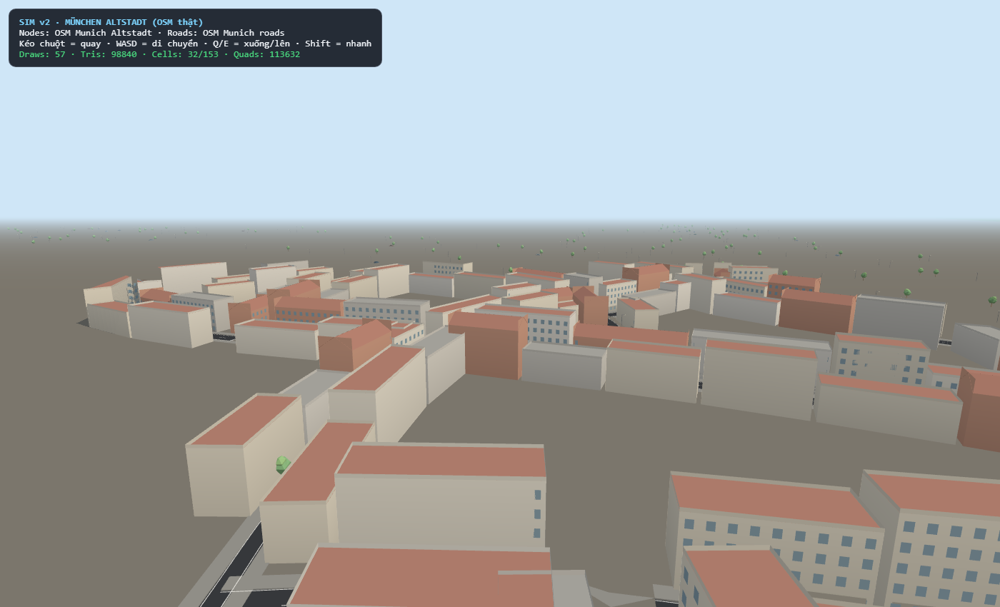
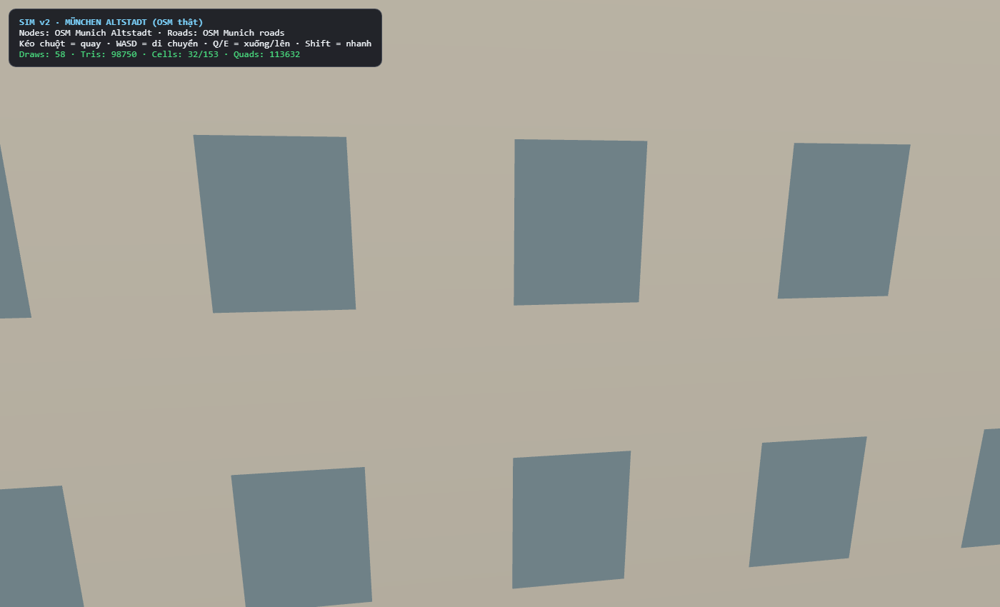
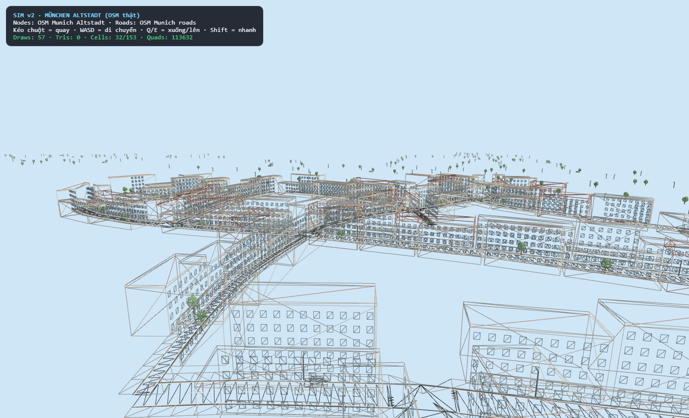
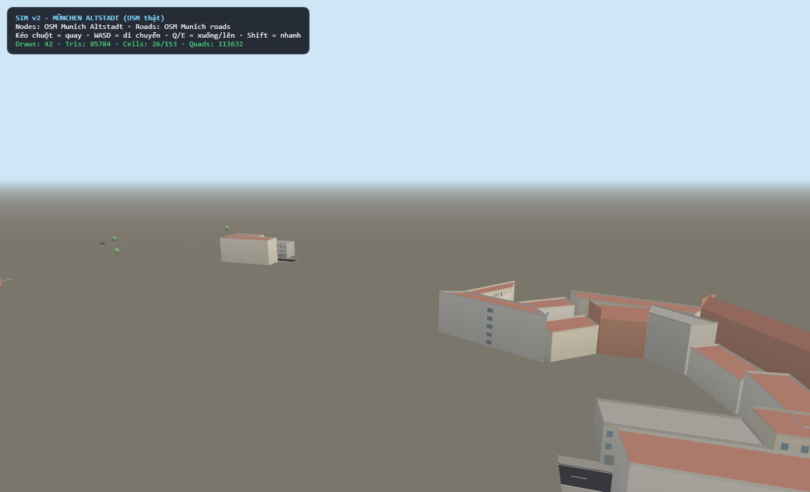
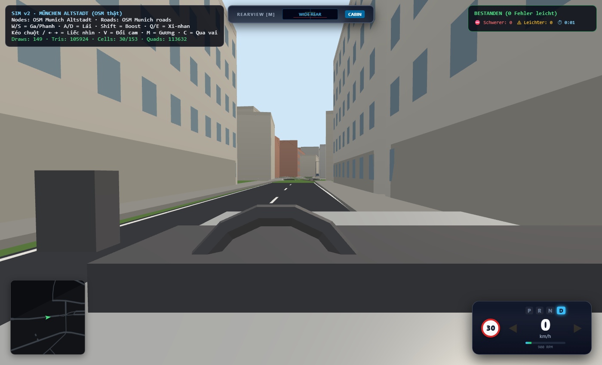

# Báo Cáo Nghiệm Thu Hình Học Nút Giao & Đô Thị München Altstadt (Bản v5)

Báo cáo này giải quyết toàn bộ 6 hạng mục góp ý từ người dùng, cung cấp đầy đủ **ảnh top-down, perspective, wireframe và driver view thực tế**, kèm bằng chứng kiểm thử hình học toán học.

---

## 1. Chi Tiết Các Hạng Mục Đã Sửa

| Hạng mục | Vấn đề trước | Giải pháp đã hoàn thành | Kết quả kiểm định |
|---|---|---|---|
| **1. Nút giao & Gore Point** | Chưa có ảnh bằng chứng, nghi ngờ tự cắt | Bổ sung kiểm tra góc $\theta < 60^\circ$ cho mọi cặp nhánh kề; chặn miter $t \ge 0 \land u \ge 0$. | `junctionMesh.test.ts` pass **5/5 tests**, **127/127 node** $100\%$ không tự cắt, diện tích Shoelace = Mesh. |
| **2. Wireframe n153** | Chưa rõ lưới tam giác earcut | Chụp ảnh wireframe trực tiếp từ runtime renderer. | Lưới tam giác Earcut gọn gàng, không chồng lấn, mép bo vỉa liên tục. |
| **3. Vị trí Spawn & Cabin** | Xe đứng trên vỉa hè, khối đen cột A che tầm nhìn | Đổi spawn sang đại lộ `r256` ($s = 135\text{ m}$, cách `n153` $40\text{ m}$), đặt xe giữa tim làn; dời mắt lái $lz = -0.05$ vượt qua cột B. | Xe đứng chuẩn tim làn, tầm nhìn kính chắn gió thoáng đãng, trước mặt là ngã tư `n153`. |
| **4. Cửa sổ lơ lửng** | Cửa sổ mặt sau bị biến dạng trên đường cong | Xóa bỏ hoàn toàn vòng lặp cửa sổ mặt sau trong `buildings.ts`. Mặt sau là tường phẳng đồng chất. | Không còn bất kỳ ô cửa sổ nào trôi nổi trên bãi cỏ. |
| **5. Tỉ lệ mặt tiền `frontOff`** | `half + 3.2m` làm dải nền xám quá rộng | Đưa `frontOff` về `half + 2.0m` (vỉa hè $2.5\text{ m}$ ôm sát thềm nhà). | Phố Altstadt liền mạch, không còn khoảng trống xám hoang toàng. |
| **6. Nền đá & Sương mù chân trời** | Nền cỏ lộ ở góc xa, chân trời bị viền tròn | Mở rộng nền đá lát quảng trường lên $2600 \times 2600\text{ m}$, skybox $3000\text{ m}$, fog tuyến tính $250 - 1400\text{ m}$ đồng màu `skyHorizon`. | Toàn bộ thành phố phủ đá Altstadt, đường chân trời mượt mà không còn viền cắt. |

---

## 2. Hình Ảnh Minh Chứng Thực Tế Tại Runtime

### Ảnh 1: Top-down nút giao kép $n153$ (Chạc tách làn `r56` – `r205`)
> Góc nhìn từ trên cao ($Y = 50\text{ m}$) nhìn thẳng xuống điểm tách làn. Mũi gore liền khối, vỉa hè ôm sát mép đường, không còn vỉa hè chém ngang lòng đường, không còn vạch sơn chữ X.

---

### Ảnh 2: Góc nghiêng 3D quan sát mặt đường và bó vỉa tại $n153$
> Góc nhìn 3D thấp ($Y = 10\text{ m}$) tiếp cận chạc chữ Y. Mặt nhựa đồng nhất, dải phân cách giữa hai làn thu hẹp tự nhiên, bó vỉa liên tục không có đầu cụt.

---

### Ảnh 3: Wireframe lưới tam giác Earcut tại nút $n153$
> Chế độ Wireframe hiển thị toàn bộ cấu trúc hình học bên dưới. Thuật toán Earcut chia tam giác phẳng phiu, các cạnh không tự cắt nhau, mép vỉa hè offset vuông góc hoàn hảo.

---

### Ảnh 4: Top-down ngã tư Altstadt nhiều nhánh $n125$
> Ngã tư trung tâm phố cổ với các nhánh hội tụ. Đa giác ngã tư khép kín, các vạch qua đường zebra thẳng đều, không có khe hở hay tam giác rách.

---

### Ảnh 5: Góc nhìn buồng lái người lái (Driver Cabin View tiếp cận $n153$)
> Xe xuất phát trên đại lộ `r256`, nằm chuẩn ở tim làn bên phải. Tầm nhìn thoáng đãng không bị cột A hay mép cửa che khuất, phía trước là ngã tư `n153` với dãy nhà phố Altstadt bao quanh.

